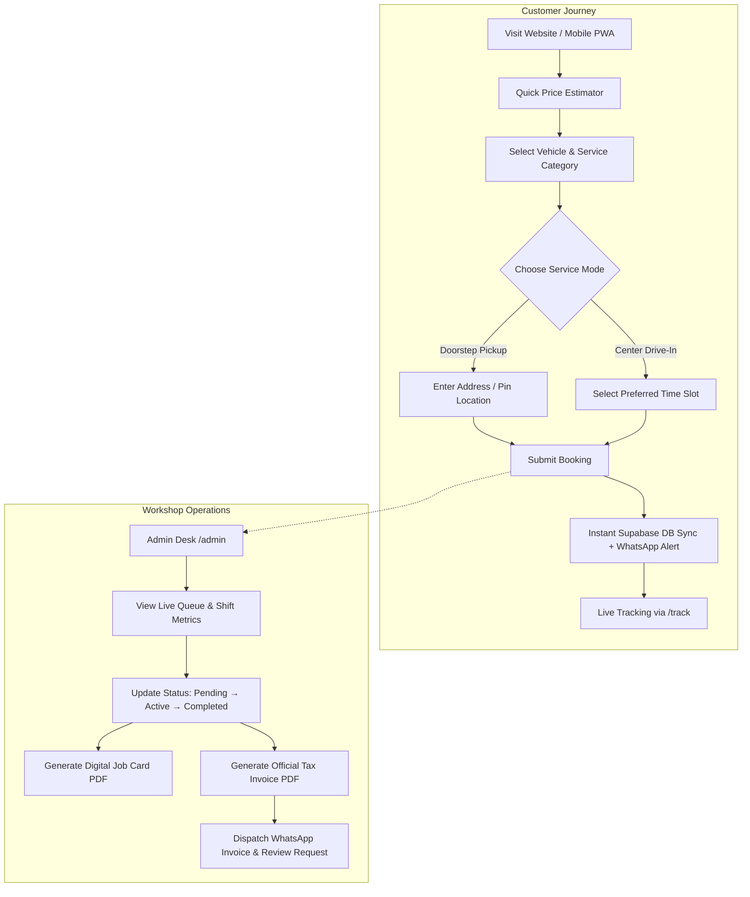

# MS Auto Care — Car Mechanic & Water Wash Web Platform

> A production-grade, full-stack automotive service and water wash management platform built with Next.js 16 (App Router), TypeScript, Tailwind CSS, and Supabase. Designed for high conversion, frictionless mobile bookings, real-time job tracking, and end-to-end workshop operations.

---

## 📌 Platform Overview

**MS Auto Care** is a modern web application designed for a premier automobile workshop and high-pressure vehicle washing center located in Panagal, Srikalahasti, Andhra Pradesh.

The platform bridges the gap between digital customer acquisition and physical workshop operations. Customers can estimate service costs, schedule doorstep vehicle pickup or center drive-in slots, and track vehicle repair status in real time. On the operational side, workshop staff manage live service queues, bill walk-in customers, export financial reports, and generate official PDF invoices and job inspection cards with one click.

---

## 🎯 Architecture & Operational Plan



### 1. Customer Acquisition Plan
- **Frictionless Booking in Under 30 Seconds:** Simple multi-step selection for vehicle type, preferred slot, doorstep pickup option, and optional add-ons without requiring mandatory account passwords.
- **Transparent Pricing:** Dynamic rate cards for all vehicle segments with an interactive real-time cost estimator.
- **Live Self-Service Tracking:** Customers track real-time vehicle progress (`Pending` &rarr; `In Progress` &rarr; `Ready`) using their phone number or booking ID.
- **Bilingual Accessibility:** Instant toggle between English and Telugu for local vehicle owners and highway travelers.

### 2. Workshop Desk Operations Plan
- **Unified Shift Management:** Real-time visibility into daily revenue, cash vs. UPI collection ratios, and vehicle throughput.
- **Walk-in Job Logging:** Rapid entry form for walk-in vehicles with custom pricing and mechanic assignment.
- **Paperless Workflow:** Instant generation of professional PDF Tax Invoices and Vehicle Inspection Job Cards with customer signatures and condition notes.
- **Automated Messaging:** Pre-formatted WhatsApp receipts, completion alerts, and Google review requests.

---

## 🚜 Fleet & Vehicle Coverage

The facility is engineered with heavy-duty industrial wash bays and precision mechanic stations capable of handling **all vehicle categories without restriction**:

| Segment | Categories | Examples | Base Wash Price |
| :--- | :--- | :--- | :--- |
| **Two-Wheelers** | Commuters, Superbikes & Scooters | Splendor, Pulsar, Activa, Royal Enfield Bullet | From ₹100 |
| **Three-Wheelers** | Passenger & Cargo Autos | Bajaj RE, Piaggio Ape, Atul Auto | ₹200 |
| **Four-Wheelers** | Hatchbacks & Compact Cars | Alto, Swift, i10, WagonR, Baleno | ₹350 |
| **Sedans** | Executive & Premium Cars | Honda City, Verna, Ciaz, Dzire, Virtus | ₹450 |
| **SUVs & MUVs** | Compact, Mid & Full-size SUVs | Creta, Brezza, Innova, XUV700, Fortuner, Thar | ₹500 – ₹600 |
| **Commercial Pickups** | Mini Trucks & Delivery Vans | Tata Ace, Mahindra Bolero Pickup, Intra, Dost | ₹450 – ₹550 |
| **Agricultural Fleet** | Farm Tractors & Harvesters | Mahindra, Swaraj, John Deere, Sonalika | ₹600 |
| **Heavy Machinery** | JCB Earthmovers, Lorries & Trucks | JCB 3DX, Tipper Trucks, Multi-axle Lorries, Buses | From ₹800 |

---

## ⚡ Core Features & Capabilities

### Customer Facing
- **Dynamic 1-Tap Booking (`/book`):** Doorstep pickup with map pin selector or center slot booking with peak-hour load indicators.
- **Interactive Price Estimator:** Instant cost calculation based on vehicle segment and detailing add-ons.
- **Before & After Slider:** Interactive touch-enabled visual demonstration of snow foam and underbody cleaning quality.
- **Live Status Tracker (`/track`):** Multi-step visual timeline tracking vehicle stage, service details, and doorstep drop address.
- **Direct Invoice Download:** Customers can download their official tax receipt PDF directly from the tracker once service is completed.
- **Searchable FAQ Accordion:** Interactive FAQ system with instant keyword filtering for common vehicle and service queries.
- **Bilingual Interface:** Full toggle support between English and Telugu (`LanguageContext`).
- **Emergency Roadside SOS:** Quick emergency modal with 1-tap call and WhatsApp hotline for 24/7 highway breakdowns.

### Workshop & Admin Desk (`/admin`)
- **Secure Access Control:** Password-protected live operational desk.
- **Real-Time Booking Feed:** Live database sync showing daily slots, customer contact details, and vehicle status.
- **Status Progression:** One-tap status updates (`pending`, `in_progress`, `completed`, `cancelled`).
- **Walk-in Fast Entry:** Log manual drive-ins with customizable billing amount, payment method (Cash/UPI), and service notes.
- **Automated WhatsApp Dispatch:** One-tap message generation for booking confirmation, invoice receipt, and review collection.
- **Shift Summary & Financial Audit:** End-of-day printable summary report and comprehensive CSV data exporter.
- **Digital Job Cards (`JobCardModal`):** Vehicle intake inspection covering fuel level, odometer, pre-existing scratches, mechanic assignment, and customer signature lines.
- **Vector PDF Invoices (`invoice-generator`):** Beautifully styled branded receipts generated client-side using `jsPDF` and `jspdf-autotable`.

### Technical & SEO Infrastructure
- **Progressive Web App (PWA):** Installable mobile app experience with service worker caching (`sw.js`) and offline readiness.
- **Schema.org Structured Data:** Complete JSON-LD entities for `AutoWash`, `AutoRepair`, `FAQPage`, and `OfferCatalog`.
- **Generative Engine Optimization (GEO):** Machine-readable root knowledge profile (`/llms.txt`) enabling AI search engines (Google AI Overviews, Gemini, ChatGPT, Perplexity) to cite service capabilities accurately.
- **Dynamic OpenGraph Social Cards:** Server-generated 1200x630 social preview images (`/opengraph-image.tsx`).

---

## 🛠️ Tech Stack

| Layer | Technology | Details |
| :--- | :--- | :--- |
| **Framework** | [Next.js 16](https://nextjs.org/) | App Router architecture with Turbopack compilation |
| **UI Library** | [React 19](https://react.dev/) | Modern hooks, transitions, and concurrent features |
| **Language** | [TypeScript 5](https://www.typescriptlang.org/) | Strict type checking across API contracts and schemas |
| **Styling** | [Tailwind CSS v4](https://tailwindcss.com/) | Modern CSS-first utility classes and responsive layouts |
| **Icons** | [Lucide React](https://lucide.dev/) | Clean, scalable icon system |
| **Database** | [Supabase](https://supabase.com/) | PostgreSQL backend with real-time client SDK |
| **PDF Generation** | [jsPDF](https://github.com/parallax/jsPDF) & AutoTable | Client-side vector PDF generation for invoices and job cards |
| **Theme System** | [next-themes](https://github.com/pacocoursey/next-themes) | Dark and light mode toggle with system preference fallback |

---

## 📂 Project Structure

```
mscarwash/
├── public/                     # Static assets, branding logos, icons, PWA manifest
│   ├── llms.txt                # Machine-readable knowledge file for AI crawlers
│   ├── manifest.webmanifest    # Progressive Web App configuration
│   ├── sw.js                   # Service Worker for offline asset caching
│   └── ms-auto-care-logo.png   # Workshop branding emblem
├── src/
│   ├── app/                    # Next.js App Router routes & metadata
│   │   ├── admin/page.tsx      # Admin desk, shift summary & queue management
│   │   ├── book/               # Online booking flow & vehicle picker
│   │   ├── pricing/page.tsx    # Complete rate card, packages & heavy fleet section
│   │   ├── track/page.tsx      # Live booking status tracker
│   │   ├── layout.tsx          # Root layout, theme wrappers & meta tags
│   │   ├── page.tsx            # Homepage with interactive components
│   │   ├── opengraph-image.tsx # Dynamic 1200x630 social share card
│   │   ├── robots.ts           # Robots.txt with explicit AI crawler rules
│   │   └── sitemap.ts          # Automated sitemap generator
│   ├── components/             # Reusable UI & business components
│   │   ├── BookingStatusTracker.tsx # Interactive tracking widget
│   │   ├── FaqSection.tsx      # Searchable FAQ accordion
│   │   ├── Footer.tsx          # 3-Column responsive footer
│   │   ├── JobCardModal.tsx    # Workshop intake inspection modal
│   │   ├── Navbar.tsx          # Responsive navigation & theme/language toggle
│   │   ├── QuickPriceEstimator.tsx # Dynamic vehicle price calculator
│   │   ├── StructuredData.tsx  # JSON-LD Schema.org rich snippets
│   │   └── TestimonialsSection.tsx # Verified customer reviews
│   ├── context/
│   │   └── LanguageContext.tsx # Bilingual translation state (English / Telugu)
│   └── lib/
│       ├── invoice-generator.ts # Client-side tax invoice PDF generator
│       ├── jobcard-generator.ts # Workshop vehicle inspection PDF generator
│       ├── supabase.ts         # Supabase client initialization & helpers
│       └── types.ts            # Core TypeScript interfaces & pricing tier data
├── package.json
└── tsconfig.json
```

---

## 🚀 Getting Started

### Prerequisites
- **Node.js**: v18.18 or higher (v20+ recommended)
- **Package Manager**: `npm`, `pnpm`, or `yarn`

### Installation

1. **Clone the repository:**
   ```bash
   git clone https://github.com/likhith3035/MScarwash.git
   cd MScarwash
   ```

2. **Install project dependencies:**
   ```bash
   npm install
   ```

3. **Configure Environment Variables:**
   Create a `.env.local` file in the project root:
   ```env
   NEXT_PUBLIC_SUPABASE_URL=your_supabase_project_url
   NEXT_PUBLIC_SUPABASE_ANON_KEY=your_supabase_anon_key
   ```

4. **Start the local development server:**
   ```bash
   npm run dev
   ```
   Open [http://localhost:3000](http://localhost:3000) in your browser.

5. **Create a production build:**
   ```bash
   npm run build
   npm run start
   ```

---

## 🌐 Deployment

The platform is optimized for zero-configuration deployment on **Vercel**:

1. Connect the GitHub repository to your Vercel account.
2. Add your `NEXT_PUBLIC_SUPABASE_URL` and `NEXT_PUBLIC_SUPABASE_ANON_KEY` in **Project Settings &rarr; Environment Variables**.
3. Deploy. Production builds automatically validate all TypeScript types, compile static pages, and serve edge routes.

---

## 📄 License & Credits

- **Application Development:** Designed and built for **MS Auto Care**.
- **All Rights Reserved.**
